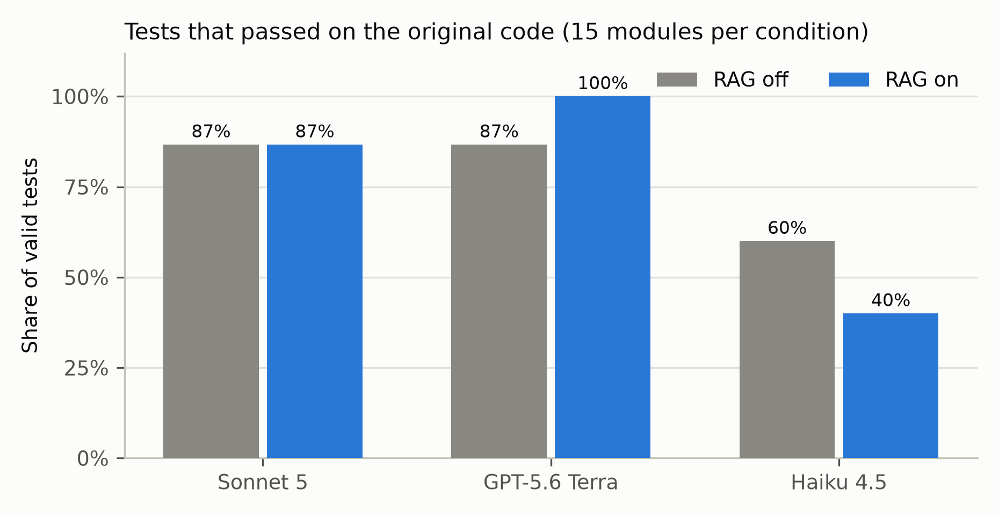
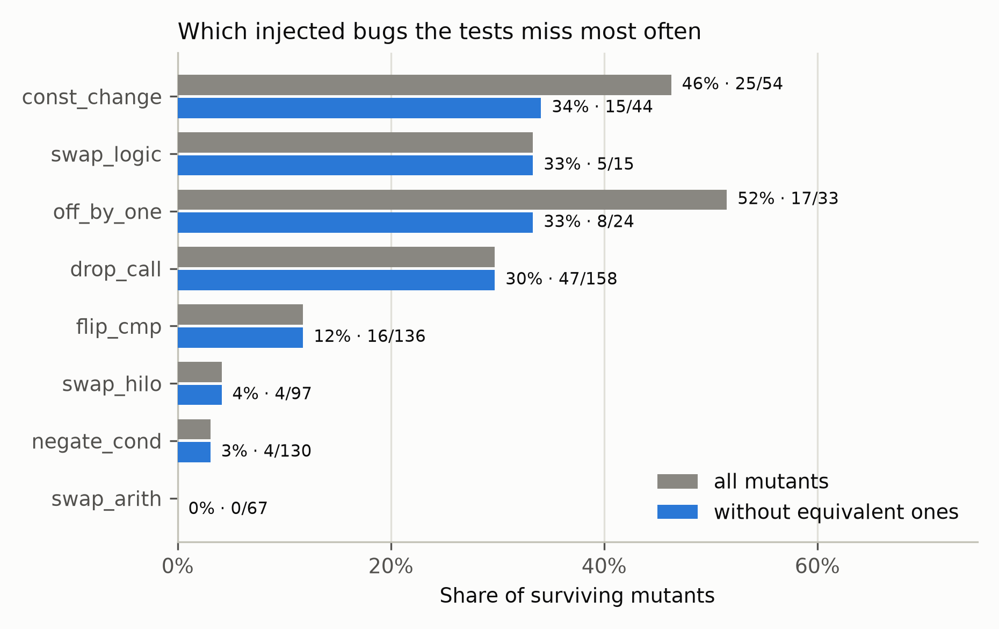

# LLM-generated tests for Arduino firmware

Practical part of my master's thesis at IT Park University (2026). The question is whether a language model can
write useful unit tests for microcontroller firmware on its own, and whether retrieval over Arduino documentation
(RAG) helps it.

For every module of a benchmark of open-source Arduino Uno projects, a model writes a test sketch. The sketch is
compiled with `arduino-cli`, run on a simulated ATmega328P and judged from what it prints over the serial port.
A test that passes on the original code is then run against ten mutants of the module, copies with one injected
bug each, and the share of mutants it catches is the measure of its quality.

## Results

**Experiment 1**: 15 simple modules (LEDs, buttons, servo, stepper and DC motors), three models (Claude Sonnet 5,
GPT-5.6 Terra, Claude Haiku 4.5), RAG off and on: 90 runs, $2.10 in API costs.

| | |
|---|---|
| Tests that compiled | 90 / 90 (89 on the first attempt) |
| Tests that passed on the original code | 69 / 90 |
| Mutants killed by those tests | 572 / 690 (83%), 572 / 671 (85%) without 4 equivalent mutants |
| Effect of RAG | none significant, for any model and metric |
| Models | GPT-5.6 Terra and Sonnet 5 write a valid test far more often than Haiku 4.5 (28 and 26 of 30 vs 15) |

Compilation is no longer the problem; correctness is. Most failing tests expect behaviour the module does not have.
RAG adds little when the whole module fits into the prompt and the API is well known to the model. Tests miss
changed constants and off-by-one errors most often, plus bugs that are only visible in pin timing.




Full analysis with the statistical tests (exact McNemar, Wilcoxon, Holm correction): `analysis/REPORT.md`, and a
review of every mutant no test killed: `analysis/survivors_review.md` (both in Russian).

**Experiment 2** repeats the study on 19 medium and complex modules (up to 782 lines in 22 files, third-party
libraries, LCDs, sensors and clocks simulated in Wokwi), three repetitions per condition. The benchmark, knowledge
base and mutant catalog are ready; only the pilot has been run so far: 3 modules, 18 runs, $3.31. The test passed
on the original code in 10 of 18 runs (GPT-5.6 Terra 6 of 6, Sonnet 5 4 of 6, Haiku 4.5 0 of 6), and valid tests
killed between 1 and 7 of 10 mutants. See `results/exp2/pilot/PILOT.md`.

## How a run works

1. With RAG on, the five closest documentation chunks are retrieved for the module (`kb/`, ChromaDB,
   `text-embedding-3-small`).
2. The model gets the module sources, its pins and the functions to test, and writes one test sketch using a small
   header-only framework, `framework/harness/testlib/test_runner.h`.
3. The sketch is compiled; on a compiler error the model gets its code and the errors back, up to two times.
4. The firmware runs on avr8js (offline), Wokwi (cloud, for modules with external devices) or a real board. The test
   prints `@RUN_BEGIN`, `@TEST <name> PASS|FAIL`, `@RUN_END`; no `@RUN_END` within 15 s is a timeout.
5. If every check passed, the same test runs against the module's 10 mutants (8 operators: flipped comparisons,
   negated conditions, swapped HIGH/LOW, changed constants, off-by-one, removed calls, swapped `&&`/`||`, swapped
   arithmetic). A mutant is killed when the test fails or hangs.

Every run keeps the prompts, the model replies, the sketches, the serial log and an event log, so each result can
be checked by hand.

## Repository

```
framework/   the system: harness (compile, run, parse), generator (LLM clients, prompts), rag, mutation, runner
benchmark/   34 adapted modules with module.yaml; INDEX.md lists sources and licenses
kb/          knowledge base documents, the ChromaDB indexes and the query embedding cache
configs/     experiment.yaml: tool versions, models, conditions, seeds
results/     main_v3: experiment 1 runs; exp2: mutant catalog and pilot; .llm_cache: every model reply
analysis/    statistics, tables, figures, REPORT.md
demo/        test_player.html, an offline page that replays runs step by step on a drawn Arduino
```

## Setup

- Python 3.12 or newer: `pip install -r requirements.txt`
- [arduino-cli](https://arduino.github.io/arduino-cli/) 1.5.1 with the `arduino:avr@1.8.8` core, either on `PATH`
  or in `tools/arduino-cli/` (see `arduino_cli.path` in the config). The libraries of the second experiment are
  installed at their pinned versions by
  `python -c "from framework.harness.compile import ensure_libraries; ensure_libraries()"`.
- Node.js, then `npm ci` in `framework/harness/avr8js`.
- Optional: [wokwi-cli](https://github.com/wokwi/wokwi-cli) and a `WOKWI_CLI_TOKEN` for the
  modules with external devices.
- API keys go into `.env` (see `.env.example`). They are not needed to replay the published runs.

Check the installation with `pytest -m "not wokwi"` and `python -m framework.harness.selftest`.

## Reproducing

Model replies are cached by a hash of the prompt in `results/.llm_cache`, and the retrieval inputs (index and
query embeddings) are in `kb/`, so experiment 1 replays without API calls and gives the same tests and verdicts:

```
python -m framework.runner.experiment --all --results-dir results/replay
python -m framework.runner.aggregate --results-dir results/replay
python analysis/analyze.py --results results/replay --out results/replay/analysis
```

Replaying all six conditions of `led_chaser` this way gives the same tests, serial logs and mutant verdicts at zero
cost. In the experiment 2 pilot, repair prompts that quote linker errors contain temporary file names, so those few
calls go to the model again. Do not run two experiments at the same time: parallel `arduino-cli` builds share a
cache and can fail.

Experiment 2 (paid, about $40, and about 1,800 Wokwi runs for all three repetitions):

```
python -m framework.runner.experiment --plan exp2 --reps 1 --max-cost 20
python -m framework.runner.aggregate --exp2
```

Single steps can be run on their own, for example
`python -m framework.generator.generate --module led_chaser --model gpt-5.6-terra --run` or
`python -m framework.mutation.run_mutation --module led_chaser --test-file my_test.ino`.

## Demo

Open `demo/test_player.html` in a browser, no server or internet needed. It replays the 90 runs of experiment 1 and
the `lcd_pomoduino` runs of the pilot: which test line runs, how the pins change, what the test prints, and the same
moment on any mutant. The page was built by `demo/build_demo.py`, which re-executes the saved firmware and fails
unless every serial log and mutant verdict matches the experiment. It needs the run build folders, which are not
published.

## License

The code is under the MIT License. The benchmark modules keep the licenses of their original projects (MIT, BSD,
Apache-2.0, CC0; see `benchmark/INDEX.md`). The knowledge base documents come from the Arduino documentation
(CC BY-SA), the Arduino libraries and the Wokwi docs, with the source and license at the top of each file and in
`kb/SOURCES.md`. `demo/vendor` contains [@wokwi/elements](https://github.com/wokwi/wokwi-elements) (MIT).
