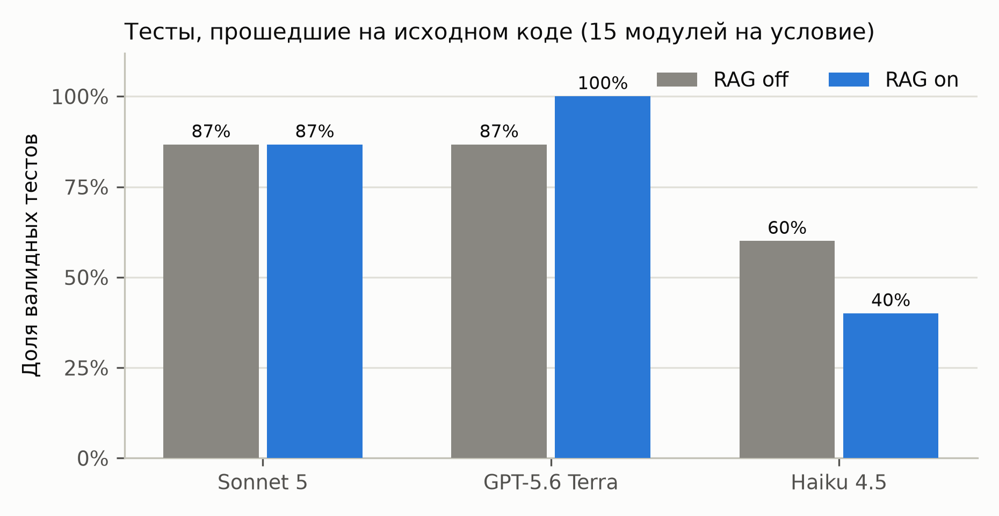
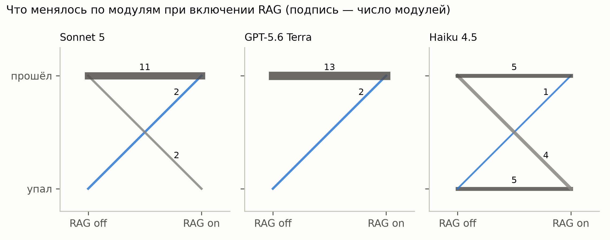
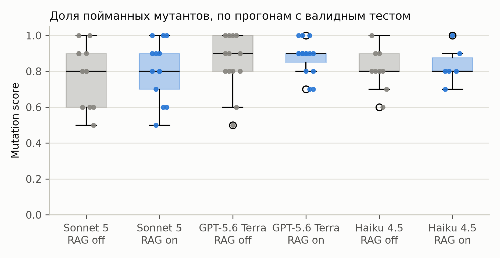
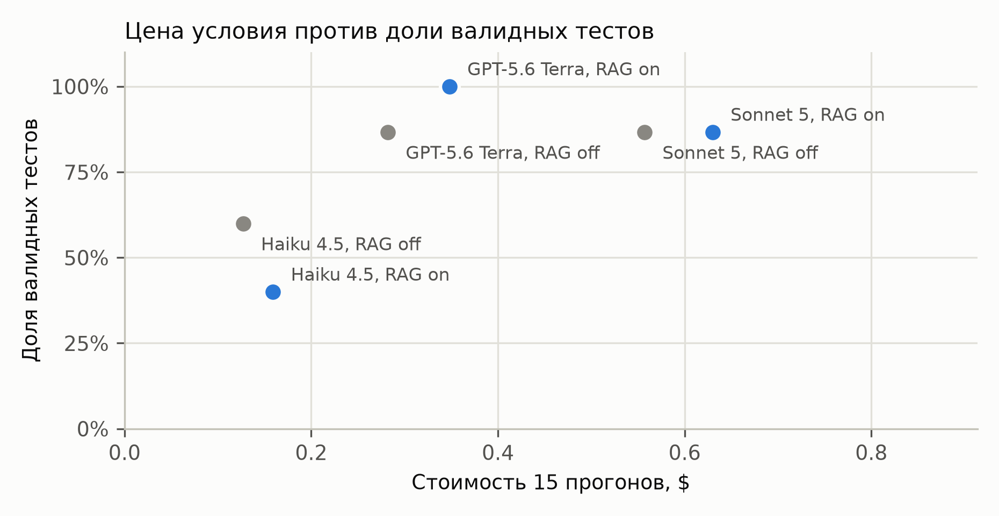
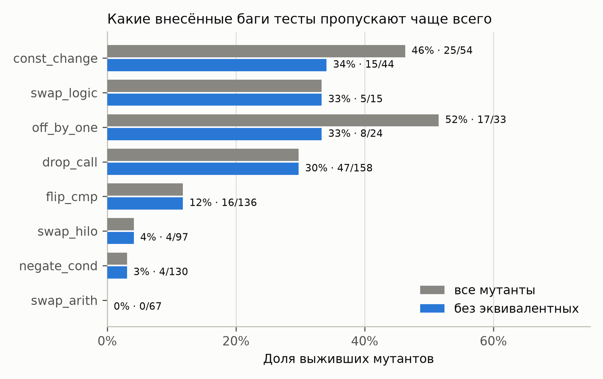
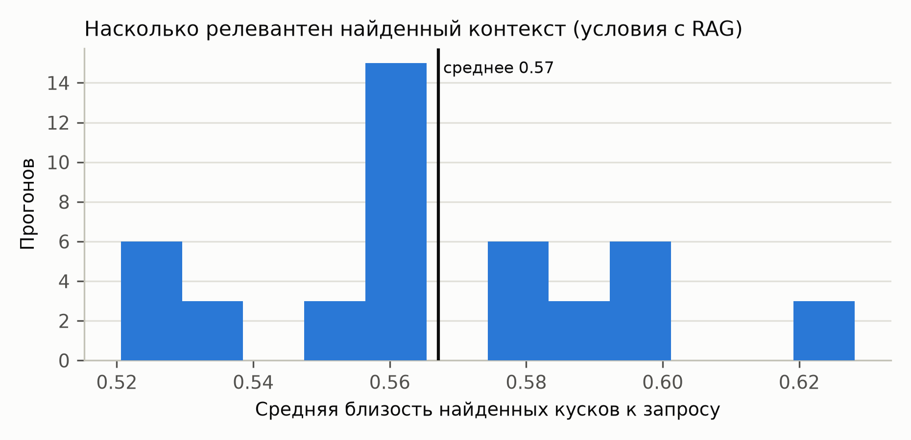

# Результаты эксперимента 1

Данные: `results/main_v3` — 90 прогонов, 690 проверок мутантов. Таблицы в `analysis/tables/`,
графики в `analysis/figures/` (300 dpi). Пересобирается командой `python analysis/analyze.py`.

## 1. Что за эксперимент

15 модулей Arduino Uno × 6 условий: три модели (Sonnet 5, GPT-5.6 Terra, Haiku 4.5) × база знаний выключена
или включена. Для каждого прогона: агент генерирует тест-скетч (до 2 починок по выводу компилятора), тест
компилируется `arduino-cli` 1.5.1 и исполняется в офлайн-симуляторе `avr8js` 0.21.1; если он прошёл на исходном
модуле, его прогоняют против 10 детерминированных мутантов (8 операторов, seed 42).
Порядок прогонов перемешан, α = 0.05. Поправка Холма применяется внутри каждого семейства из трёх
сравнений (по одному на модель); семейства — «валидные тесты», «mutation score», «отдельные мутанты»,
и отдельно два семейства в сравнении моделей.

| Показатель | Значение |
|---|---|
| Скомпилировалось | 90/90 (100%), с первой попытки 99% |
| Тест прошёл на исходном коде | 69/90 (77%) |
| Mutation score (прогоны с валидным тестом) | среднее 0.83, медиана 0.80, от 0.5 до 1.0 |
| Мутанты | убито 572 из 690 (83%) |
| То же без 4 эквивалентных мутантов | убито 572 из 671 (85.2%), mutation score: среднее 0.85, медиана 0.89 |
| Стоимость | $2.10 за 90 прогонов |

| model | rag | runs | compile_at_1 | compile_at_k | valid_tests | valid_rate | ci_low | ci_high | mean_tests | mutation_score_mean | mutation_score_n | cost_usd | cost_per_valid_test |
|---|---|---|---|---|---|---|---|---|---|---|---|---|---|
| claude-haiku-4-5 | off | 15 | 0.933 | 1.0 | 9 | 0.6 | 0.357 | 0.802 | 8.3 | 0.811 | 9 | 0.127 | 0.0141 |
| claude-haiku-4-5 | on | 15 | 1.0 | 1.0 | 6 | 0.4 | 0.198 | 0.643 | 8.5 | 0.833 | 6 | 0.159 | 0.0266 |
| claude-sonnet-5 | off | 15 | 1.0 | 1.0 | 13 | 0.867 | 0.621 | 0.963 | 6.9 | 0.785 | 13 | 0.557 | 0.0428 |
| claude-sonnet-5 | on | 15 | 1.0 | 1.0 | 13 | 0.867 | 0.621 | 0.963 | 7.0 | 0.808 | 13 | 0.63 | 0.0485 |
| gpt-5.6-terra | off | 15 | 1.0 | 1.0 | 13 | 0.867 | 0.621 | 0.963 | 6.2 | 0.846 | 13 | 0.282 | 0.0217 |
| gpt-5.6-terra | on | 15 | 1.0 | 1.0 | 15 | 1.0 | 0.796 | 1.0 | 6.7 | 0.88 | 15 | 0.348 | 0.0232 |

## 2. RQ1. Генерирует ли агент валидные тесты

Компиляция упирается в потолок: 90 из 90 тестов собрались, починка понадобилась
1 раз. Различий между моделями и условиями по компиляции нет.

Настоящий барьер дальше: 21 из 90 тестов упали на исходном, правильном коде, то есть сами содержали
неверные ожидания. Доля валидных тестов по условиям — в таблице выше (с 95% интервалом Уилсона),
разбор упавших проверок — `analysis/tables/t6_failures.csv`, всего их 32.

## 3. RQ2. Помогает ли RAG

Парные сравнения внутри модуля: один и тот же модуль с выключенной и включённой базой знаний.

**Валидные тесты (McNemar по 15 модулям на модель).**

| model | outcome | n_pairs | off_only | on_only | p | p_holm | p_holm_significant |
|---|---|---|---|---|---|---|---|
| claude-sonnet-5 | valid test | 15 | 2 | 2 | 1.0 | 1.0 | False |
| gpt-5.6-terra | valid test | 15 | 0 | 2 | 0.5 | 1.0 | False |
| claude-haiku-4-5 | valid test | 15 | 4 | 1 | 0.375 | 1.0 | False |

**Mutation score (Wilcoxon по модулям, где тест прошёл в обоих условиях).**

| model | outcome | mean_off | mean_on | n_pairs | n_changed | mean_diff | median_diff | p | p_holm | p_holm_significant |
|---|---|---|---|---|---|---|---|---|---|---|
| claude-sonnet-5 | mutation score | 0.782 | 0.8 | 11 | 4 | 0.0182 | 0.0 | 0.625 | 1.0 | False |
| gpt-5.6-terra | mutation score | 0.846 | 0.877 | 13 | 7 | 0.0308 | 0.0 | 0.3594 | 1.0 | False |
| claude-haiku-4-5 | mutation score | 0.84 | 0.8 | 5 | 1 | -0.04 | 0.0 | 1.0 | 1.0 | False |

**По отдельным мутантам (McNemar; пара — один и тот же мутант в обоих условиях, 290 пар).**

| model | outcome | killed_off | killed_on | n_pairs | off_only | on_only | p | p_holm | p_holm_significant |
|---|---|---|---|---|---|---|---|---|---|
| claude-sonnet-5 | mutant killed | 86 | 88 | 110 | 2 | 4 | 0.6875 | 1.0 | False |
| gpt-5.6-terra | mutant killed | 110 | 114 | 130 | 3 | 7 | 0.3438 | 1.0 | False |
| claude-haiku-4-5 | mutant killed | 42 | 40 | 50 | 2 | 0 | 0.5 | 1.0 | False |

Направление эффекта по mutation score: Sonnet 5 +0.018 (выше с RAG), GPT-5.6 Terra +0.031 (выше с RAG), Haiku 4.5 -0.040 (ниже с RAG). По валидным тестам: Sonnet 5 +0 модуля, GPT-5.6 Terra +2 модуля, Haiku 4.5 -3 модуля.
Значимость после поправки Холма (валидные тесты): Sonnet 5 p=1.0, GPT-5.6 Terra p=1.0, Haiku 4.5 p=1.0 — ни одно сравнение не значимо.
Гипотеза H1, записанная до эксперимента (RAG не влияет на компиляцию), не отвергается: компиляция на потолке.

## 4. RQ3. Какая модель лучше

Парные сравнения моделей по (модуль, условие RAG); стоимость — за 15 прогонов условия.

| model_a | model_b | valid_a | valid_b | valid_a_only | valid_b_only | p_valid | mutants_paired | killed_a_only | killed_b_only | p_mutants | p_valid_holm | p_valid_holm_significant | p_mutants_holm | p_mutants_holm_significant |
|---|---|---|---|---|---|---|---|---|---|---|---|---|---|---|
| claude-sonnet-5 | gpt-5.6-terra | 26 | 28 | 2 | 4 | 0.6875 | 240 | 2 | 18 | 0.0004 | 0.6875 | False | 0.0012 | True |
| claude-sonnet-5 | claude-haiku-4-5 | 26 | 15 | 13 | 2 | 0.0074 | 130 | 2 | 3 | 1.0 | 0.0148 | True | 1.0 | False |
| gpt-5.6-terra | claude-haiku-4-5 | 28 | 15 | 14 | 1 | 0.001 | 140 | 8 | 0 | 0.0078 | 0.003 | True | 0.0156 | True |

## 5. RQ4. Ловят ли тесты внесённые баги

| operator | killed | runs | survived | kill_rate | kill_rate_rag_off | kill_rate_rag_on |
|---|---|---|---|---|---|---|
| const_change | 29 | 54 | 25 | 0.537 | 0.407 | 0.667 |
| drop_call | 111 | 158 | 47 | 0.703 | 0.667 | 0.74 |
| flip_cmp | 120 | 136 | 16 | 0.882 | 0.886 | 0.879 |
| negate_cond | 126 | 130 | 4 | 0.969 | 0.97 | 0.969 |
| off_by_one | 16 | 33 | 17 | 0.485 | 0.438 | 0.529 |
| swap_arith | 67 | 67 | 0 | 1.0 | 1.0 | 1.0 |
| swap_hilo | 93 | 97 | 4 | 0.959 | 0.98 | 0.936 |
| swap_logic | 10 | 15 | 5 | 0.667 | 0.667 | 0.667 |

Серые полосы — все мутанты, синие — без эквивалентных; серые подписаны только там, где они отличаются.

**Выжившие мутанты.** 15 из 150 мутантов не убил ни один тест ни в одном условии
(`analysis/tables/t8_survivors.csv`). Каждый разобран вручную по исходнику модуля, разбор —
`analysis/survivors_review.md`, класс и причина — в столбцах `review` и `reason`:

| Класс | Мутантов | Что это значит |
|---|---|---|
| `equivalent` | 4 | наблюдаемое поведение не меняется; исключены из пересчёта ниже |
| `unobservable` | 2 | отличие есть только внутри одного блокирующего вызова, итог и время те же |
| `needs_signal` | 4 | ловится только замером времени (`millis()`) или сигнала на пине (`pulseIn()`) |
| `test_gap` | 5 | пропуск в тестах: убивается обычной проверкой пина или вызовом API |

**Пересчёт без эквивалентных мутантов.** Mutation score по определению считается без эквивалентных мутантов;
сырые таблицы выше оставлены для сопоставимости с первой сборкой. Убито 572 из 671
(85.2% против 82.9%), средний score 0.852 против 0.829.

| operator | killed | runs | survived | kill_rate | kill_rate_rag_off | kill_rate_rag_on |
|---|---|---|---|---|---|---|
| const_change | 29 | 44 | 15 | 0.659 | 0.524 | 0.783 |
| drop_call | 111 | 158 | 47 | 0.703 | 0.667 | 0.74 |
| flip_cmp | 120 | 136 | 16 | 0.882 | 0.886 | 0.879 |
| negate_cond | 126 | 130 | 4 | 0.969 | 0.97 | 0.969 |
| off_by_one | 16 | 24 | 8 | 0.667 | 0.583 | 0.75 |
| swap_arith | 67 | 67 | 0 | 1.0 | 1.0 | 1.0 |
| swap_hilo | 93 | 97 | 4 | 0.959 | 0.98 | 0.936 |
| swap_logic | 10 | 15 | 5 | 0.667 | 0.667 | 0.667 |

Mutation score по RAG (Wilcoxon, `t3_rag_score_adj.csv`):

| model | outcome | mean_off | mean_on | n_pairs | n_changed | mean_diff | median_diff | p | p_holm | p_holm_significant |
|---|---|---|---|---|---|---|---|---|---|---|
| claude-sonnet-5 | mutation score | 0.804 | 0.822 | 11 | 4 | 0.0182 | 0.0 | 0.625 | 1.0 | False |
| gpt-5.6-terra | mutation score | 0.865 | 0.897 | 13 | 7 | 0.0327 | 0.0 | 0.2656 | 0.7968 | False |
| claude-haiku-4-5 | mutation score | 0.858 | 0.818 | 5 | 1 | -0.04 | 0.0 | 1.0 | 1.0 | False |

McNemar по отдельным мутантам (`t4_rag_mutants_adj.csv`) и сравнение моделей по мутантам не меняются:
эквивалентный мутант не убит ни в одном условии, то есть всегда даёт совпадающую пару, а p считается только
по несовпадающим.

## 6. Контекст RAG

Средняя близость найденных кусков к запросу — 0.57
(от 0.52 до 0.63).
Какие именно куски попали в промпт, записано в `rag_chunks.json` каждого прогона.

## 7. Угрозы валидности

- **Малое n.** 15 модулей, один прогон на условие: случайность генерации не усреднена. Размеры эффекта важнее p.
- **Симулятор вместо платы.** `avr8js` моделирует голую плату: внешние детали не подключены, аналоговые входы
  читают 0, висящий вход детерминированно держит последний уровень (на плате он не определён). Подтяжка
  эмулируется отдельно: библиотека её не моделирует, и без этого правильные тесты падали.
- **Потолок mutation score.** Распределение прижато к 1, различия между условиями малы по величине.
- **Упрощения против протокола диплома.** 15 модулей вместо 50, 6 условий вместо 6 исходных, 8 операторов
  мутаций вместо 12, α = 0.05 с поправкой Холма вместо 0.01 с Бонферрони, RAG с одной стратегией чанкинга.
- **Мутаторы-артефакты.** Удаление `delay()` и `pinMode()` исключено: их исход решает не тест, а модель
  симулятора.
- **Ручная разметка выживших мутантов.** Классы в `t8_survivors.csv` проставил один исследователь, второй
  независимой разметки нет. Эквивалентность обоснована по коду (`analysis/survivors_review.md`), но не доказана
  формально; при спорном решении менялся бы только пересчёт `*_adj`, сырые таблицы от разметки не зависят.

## 8. Выводы

Числа здесь подставляются из таблиц выше при каждой сборке; примеры подобраны вручную.

**RQ1. Валидные тесты.** Синтаксис для агента не проблема: компилируются 90 из 90
тестов, 99% с первой попытки. Проблема в оракуле, то есть в ожиданиях самого теста:
21 из 90 тестов падают на правильном коде, и 15 из них написал Haiku 4.5.
Три типичные ошибки из `t6_failures.csv`:

1. *Целочисленная арифметика* (`dc_motor_pot`, Haiku 4.5, RAG on). Тест ждёт
   `motor_power_from_reading(512) == 128`, а `map()` отбрасывает дробную часть 127.6 и даёт 127.
2. *Неверная модель состояния* (`led_chaser`, Sonnet 5, RAG on). Тест ждёт, что первый `chaser_step()` после
   `chaser_init()` зажжёт позицию 1, а модуль стартует с −1 и встаёт на 0.
3. *Артефакт симулятора* (`dc_motor_pot`, GPT-5.6 Terra, RAG off). Тест переводит вход потенциометра в
   OUTPUT HIGH и ждёт мощность 255 после `motor_update()`. На ATmega328P АЦП меряет напряжение на пине, и
   проверка, скорее всего, прошла бы, а в `avr8js` `analogRead` всегда возвращает 0. Это случай, обратный RQ2
   протокола диплома: тест падает в симуляторе, хотя на плате, вероятно, прошёл бы.

**RQ2. RAG.** Влияния не найдено ни по одной метрике. Валидные тесты, p после поправки Холма:
Sonnet 5 p=1.0, GPT-5.6 Terra p=1.0, Haiku 4.5 p=1.0. Mutation score:
Sonnet 5 +0.018 (выше с RAG), GPT-5.6 Terra +0.031 (выше с RAG), Haiku 4.5 -0.040 (ниже с RAG); ни одно сравнение не значимо, и пересчёт без эквивалентных мутантов этого не меняет
(наименьшее p_holm = 0.7968). Направления к тому же расходятся: по валидным
тестам Sonnet 5 +0 модуля, GPT-5.6 Terra +2 модуля, Haiku 4.5 -3 модуля. Это совпадает с ожиданием из H1–H3: исходник модуля целиком помещается в промпт, и база
знаний почти ничего не добавляет.

**RQ3. Модели.** GPT-5.6 Terra и Sonnet 5 дают валидный тест заметно чаще Haiku 4.5:
28/30 и 26/30 против 15/30
(p_holm = 0.003 и 0.0148). Между собой GPT
и Sonnet по валидности не различаются (p_holm = 0.6875), но тесты GPT убивают
больше мутантов: в несовпадающих парах 18 в пользу GPT против
2 (p_holm = 0.0012). При этом GPT
в 1.9 раза дешевле: $0.63 за 30
прогонов против $1.19 у Sonnet. Haiku дешевле всех ($0.29), но
15 из 30 его тестов невалидны. Лучшее соотношение цены и качества у GPT-5.6 Terra.

**RQ4. Ловят ли тесты баги.** Валидные тесты убивают 85% неэквивалентных мутантов (сырой
подсчёт 83%). Легко ловятся перевёрнутые условия и арифметика: negate_cond 97%,
swap_arith 100%, swap_hilo 96%. Хуже всего ловятся изменённые
константы, сдвиги границ и удалённые вызовы: const_change 66%, off_by_one
67%, drop_call 70%; у swap_logic столько же, 67%, но
всего на 15 проверках. До разметки off_by_one выглядел самым трудным
оператором (48%), но эта оценка в основном держалась на двух эквивалентных мутантах.

Из 11 неэквивалентных выживших 5 — пропуски
в самих тестах: не проверены пины после смены состояния (`dc_motor_pot #6`, `dual_hbridge #4`), функция с
аппаратным входом (`joystick_motor #8`), граничное значение (`led_breathing #2`), а одна проверка идёт через
собственный API модуля (`led_chaser #1`). Остальные 6
видны только при наблюдении за временем или сигналом. Три примера из `t8_survivors.csv`:

1. `led_chaser #1`: в массиве пинов 7 заменён на 14. Тесты считают горящие светодиоды через `chaser_count_on()`,
   а она читает тот же изменённый массив, так что проверка согласна сама с собой. Мутанта убил бы один
   `ASSERT_PIN(7, HIGH)` после `chaser_light_only(5)`.
2. `traffic_light #3`: из цикла мигания удалён `digitalWrite(GREEN, LOW)`, и зелёный горит постоянно вместо
   мигания. Итоговое состояние и длительность вызова те же, поэтому последовательный тест через serial-протокол
   этого не видит. Нужен наблюдатель сигнала во времени (логический анализатор или HIL-стенд). Это довод в пользу
   аппаратного уровня из протокола диплома.
3. `dc_motor_pot #9`: `raw > 1023` заменено на `raw > 1024`. Мутант эквивалентен: при raw = 1024 `map()` даёт
   те же 255, поэтому он исключён из пересчёта.

**Итог.** На простых модулях агент с недорогой сильной моделью (GPT-5.6 Terra) пишет валидный тест в
93% случаев, и эти тесты убивают в среднем
89% неэквивалентных мутантов. RAG при исходнике в промпте
ничего не даёт. Около половины оставшихся пропусков лежит за пределами того, что видит последовательный тест:
время, ширина импульса, поведение внутри блокирующего вызова.
